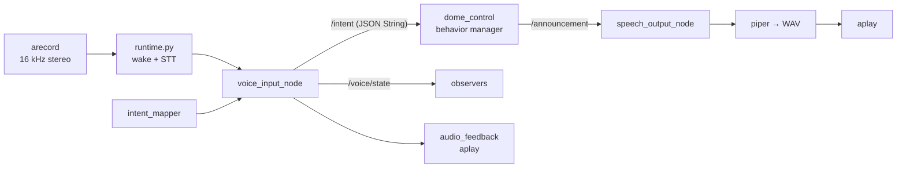

# 00 — dome_voice: Theory of Operation

## What this package is

`dome_voice` gives the DOME robot ears and a mouth. It has two halves, and they never talk to each other directly:

- **Voice input.** Listen for a wake word, capture a short spoken command, turn it into a structured *intent*, and publish it on `/intent`.
- **Speech output.** Listen on `/announcement` and speak each message aloud with the Piper text-to-speech engine.

Everything else in the stack (`dome_control`'s behaviour manager, `dome_mission`) consumes intents and produces announcements. `dome_voice` is only the audio boundary.

## The one design constraint: a ROS-free core

The listening pipeline lives in `runtime.py`, which **imports nothing from ROS**. The ROS node around it, `voice_input_node.py`, is about 100 lines of wiring.

That split exists for testability:

- Audio capture, wake detection and speech recognition can be driven by **fake streams, fake models and a fake clock**.
- The loop's "should I keep going?" check is an injected `ok_fn`. In production it is `rclpy.ok`; in tests it is a lambda.
- The same core also runs as a plain command-line smoke test (`python3 -m dome_voice.runtime --trials 5`) and from `testvoice.py`, with no ROS at all.

## Package layout

```
dome_voice/
├── runtime.py            # audio capture, wake detection, STT, config — no ROS
├── intent_mapper.py      # transcript → intent dict — no ROS, no audio
├── audio_feedback.py     # confirmation beeps via aplay — no ROS
├── voice_input_node.py   # ROS node: runtime + mapper → /intent, /voice/state
└── speech_output_node.py # ROS node: /announcement → Piper → aplay
launch/robot.launch.py    # starts both nodes
config/voice.yaml         # the robot's voice settings (passed by the launch file)
testvoice.py              # one-turn diagnostic, no ROS
```

## How the pieces connect



## One voice turn

A *turn* is one wake word plus one command:

1. **Wake.** Read 80 ms chunks from the microphone and score each one with an **openWakeWord** neural model. Enough consecutive chunks above a threshold count as a wake.
2. **Beep and listen.** The node publishes `LISTENING` and plays a high beep. The runtime then feeds chunks to **Vosk**, a speech recogniser held to a *grammar* of eight command words.
3. **End of command.** Capture stops when Vosk reports a final result, when silence lasts long enough, or when a timeout fires. The silence level is *adaptive*: it is measured from the room's noise during the wake phase.
4. **Map.** `IntentMapper` turns the text into `{"name": "turn_right", "source": "voice", "slots": {}}`.
5. **Publish and confirm.** The intent goes out on `/intent`, followed by a short low beep for "understood", or a long lower beep for "didn't get that".

## Key design decisions

- **A constrained grammar, not free transcription.** Vosk only chooses among the words the robot understands, plus `[unk]`. Accuracy on those words is high, and anything else becomes `[unk]`, which the mapper rejects cleanly.
- **`arecord` as a subprocess, not pyaudio.** It avoids ALSA device-index conflicts on the Pi. The runtime simply reads raw PCM from a pipe.
- **Beeps instead of speech for feedback.** A beep takes milliseconds and needs no model. Speech output is reserved for real announcements.
- **Speech output is configured by environment variables**, which the launch file sets (chapter 05).

## Reading guide

| Chapter | File | Read it for |
|---|---|---|
| 01 | `runtime.py` | the audio pipeline: config, filtering, wake, capture |
| 02 | `intent_mapper.py` | how text becomes an intent |
| 03 | `voice_input_node.py` | the ROS shell and the state topic |
| 04 | `speech_output_node.py` | Piper synthesis, gain, playback |
| 05 | `launch/robot.launch.py` | how the nodes are started and configured |
| X01 | `audio_feedback.py` | the beep synthesiser |
| X02 | `testvoice.py` | the one-turn diagnostic |

## Current state on the robot (2026-11-19)

**The code is complete, but the Pi is missing its runtime.** The piper binary and voice model, `openwakeword`, `vosk` and its model, and the `hey_marvin` wake model are not installed. `voice_input` crashes on import, and `speech_output` reports the missing piper binary on each announcement. dome2's `TF05` records the details.
