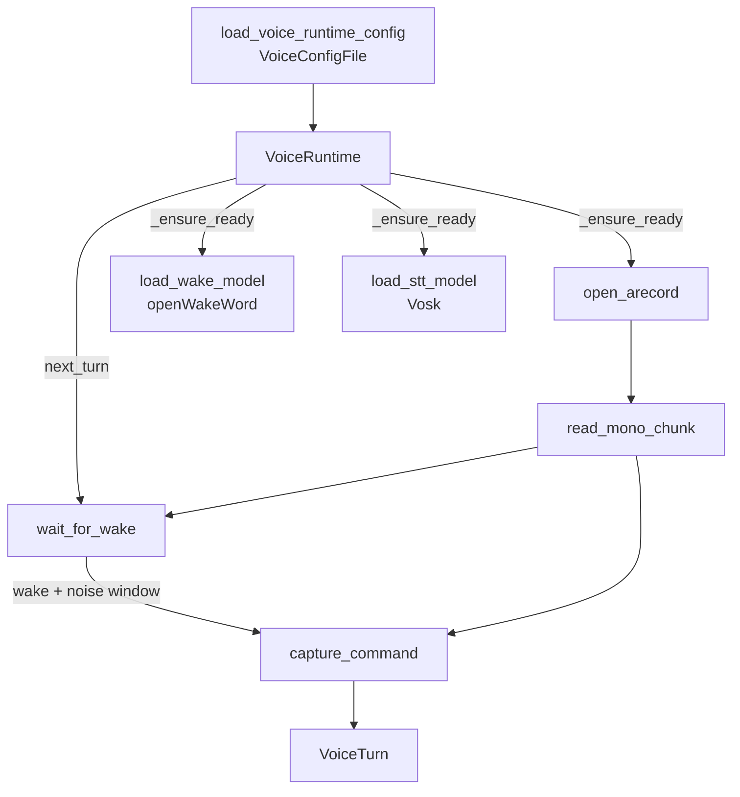
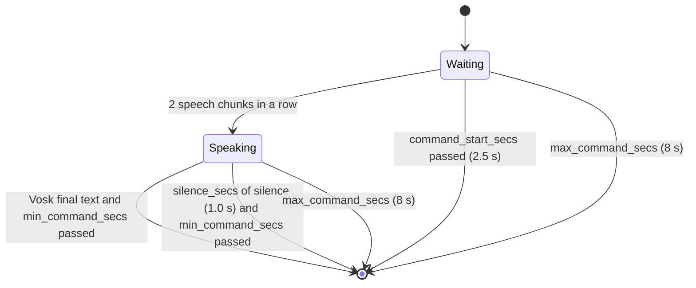

# 01 — `runtime.py`: The Voice Pipeline

## Introduction

`runtime.py` is the whole listening pipeline, in one ROS-free module. It answers a single question, over and over: *what did the person just say to the robot?*

It does that in two phases:

- **Wait for the wake word**, scoring the microphone stream chunk by chunk.
- **Capture the command**, with a constrained speech recogniser and an adaptive end-of-speech detector.

Around those two phases sit a configuration loader, a tiny streaming filter, and a `VoiceRuntime` class that owns the microphone process and the models.



## The audio format

Three constants define the stream everything else assumes:

```python
RATE = 16000
CHUNK = 1280
WAKE_SKIP_CHUNKS = 1
```

- **16 kHz** is what both openWakeWord and Vosk's small English model expect.
- **1280 samples is 80 ms**, the frame size openWakeWord is built around. Every loop in this file works in these 80 ms steps, so durations in the config are turned into chunk counts.
- **`WAKE_SKIP_CHUNKS`** throws away one chunk after the wake, presumably the tail of the wake word. It is much shorter than the 0.3 s wake beep that plays in between (chapter X01).

## Configuration: defaults once, YAML on top

The config follows the pattern used across the DOME stack (dome_vision, dome_semantic, dome_control's `spin_survey`). It was adopted here in F02 (2026-11-19).

| Layer | Holds |
|---|---|
| `VoiceConfigFile` (code) | every default, written once |
| `config/voice.yaml` | what differs on this robot, including tuned values |
| overrides (CLI flags) | a one-run change |

### Two classes, two jobs

- **`VoiceConfigFile`** is a strict pydantic model with the YAML's nested shape: `capture_card`, `playback_card`, `stream_settings`, `sox_chain`, `beep`. It holds **the only defaults**, and it validates: ranges such as `0 ≤ threshold ≤ 1`, types, and an empty grammar.
- **`VoiceRuntimeConfig`** is a flat frozen dataclass with **no defaults**. It is what the runtime and node read (`config.threshold`, `config.beep_fail_freq`). It is built only by `VoiceConfigFile.to_runtime_config`.

Keeping the flat dataclass meant no call site had to change, and tests can still derive variants with `dataclasses.replace`.

### Strict means a typo fails

```python
class StrictModel(BaseModel):
    model_config = ConfigDict(extra="forbid", frozen=True)
```

**An unknown key raises, and names itself.** With `treshold: 0.7` in the YAML, loading fails with `stream_settings.treshold — Extra inputs are not permitted`. The old loader ignored unknown keys, so a misspelling silently did nothing, which is the same bug dome_vision forbids extras to prevent.

### Loading

`load_voice_runtime_config(path, overrides)` works in three steps:

1. **Find the YAML**: `path`. With none, use no file, and `source_path` reads `defaults`. **No environment variable chooses the file** (dome2 F07): the ROS node gets its path as a parameter from the launch file.
2. **Apply overrides** to the YAML's data, before validation. Overrides use flat names, so `set_flat_key` finds each one's section: `threshold` goes to `stream_settings`, `beep_wake_freq` to `beep.wake_freq`, `highpass` to `sox_chain`. An unknown name raises.
3. **Validate the whole thing once**, so a bad override fails exactly like a bad YAML value.

**A named file that doesn't exist raises.** Running silently on the defaults would hide a wrong path.

### Small conveniences

- `none`, `None` and `""` mean "no value" for `silence_dbfs` and the two cutoffs.
- The grammar accepts a list or one comma-separated string.

### Where tuning goes

**Results from `~/tune` are pasted into `config/voice.yaml`.** The file's shape mirrors tune's `active.yaml` for that reason. The robot's YAML now writes out every value it uses, including `threshold: 0.3` and `wake_hits: 1`, so the file says what the robot does.

The old in-code table had 0.7 and 3, tuned for `alexa`. The robot never ran with them, because a YAML used to *replace* that table instead of overriding it. They are recorded in the YAML's comment as the starting point for re-tuning `hey_marvin`.

## Reading the microphone

### arecord as the source

```python
def open_arecord(card: int) -> subprocess.Popen:
    return subprocess.Popen(
        ["arecord", "-q", "-D", f"hw:{card},0",
         "-f", "S16_LE", "-r", str(RATE), "-c", "2"],
        stdout=subprocess.PIPE, stderr=subprocess.DEVNULL,
        bufsize=CHUNK * 4,
    )
```

The Seeed 2-mic board records in **stereo**, and `hw:` addresses the card directly, with no ALSA plugin resampling. The pipe's buffer is sized to exactly one chunk of stereo 16-bit audio: 1280 samples × 2 channels × 2 bytes.

### One chunk: stereo to clean mono

```python
def read_mono_chunk(stream, n_samples=CHUNK, live_filter=None):
    raw = stream.read(n_samples * 4)
    if len(raw) < n_samples * 4:
        return None
    stereo = np.frombuffer(raw, dtype=np.int16).reshape(-1, 2)
    mono = stereo.mean(axis=1).astype(np.float32)
    mono -= float(np.mean(mono))
    ...
```

Three steps, each with a reason:

- **A short read returns `None`.** That means the stream ended (arecord died, or a test's fake stream ran dry). Every loop treats `None` as "stop".
- **Averaging the two microphones** gives a little noise reduction for free, because uncorrelated noise partly cancels.
- **Subtracting the chunk's mean removes DC offset**, a constant bias some ADCs add. Left in, it would inflate every loudness reading.

### The live bandpass filter

When `live_filter` is on, each chunk goes through `LiveBandpass`: a **first-order RC highpass at 120 Hz, then a first-order RC lowpass at 4 kHz**. Speech energy sits mostly in between; motor hum and fan rumble sit below it.

These are the textbook discrete RC filters:

- Highpass: `y[n] = α · (y[n−1] + x[n] − x[n−1])`, with `α = RC / (RC + dt)`.
- Lowpass: `y[n] = y[n−1] + α · (x[n] − y[n−1])`, with `α = dt / (RC + dt)`.
- In both, `RC = 1 / (2π f_cutoff)` and `dt = 1 / 16000`.

**The filter keeps its state between chunks** (`hp_x`, `hp_y`, `lp_y`). Without that, every 80 ms boundary would restart the filter and add a click. The cutoffs match the SoX chain used in `~/tune`, so experiments and production hear the same audio.

**It runs a Python loop per sample**, 16 000 iterations a second per filter, which makes it the slowest code in the package. `scipy.signal.lfilter` with carried state would do the same work in C.

## Loudness and the adaptive silence cutoff

Loudness is measured in **dBFS**, decibels relative to full scale:

```python
def rms_dbfs(samples):
    rms = np.sqrt(np.mean(samples.astype(np.float32) ** 2))
    return 20 * math.log10(rms / 32768) if rms > 0 else -96.0
```

0 dBFS is the loudest possible 16-bit signal; a quiet room is around −50. Pure digital silence would be −∞, so it is pinned at −96, the dynamic range of 16-bit audio.

### Learning the room during wake

While waiting for the wake word, every chunk that **doesn't** score as wake goes into a 50-chunk (4 s) `deque`. By the time the person speaks, the runtime holds four seconds of what this room sounds like when nobody is talking to it.

`noise_floor` then estimates the background:

```python
def noise_floor(samples):
    quiet = [value for value in samples if value <= FLOOR_MAX_DBFS]
    values = quiet or list(samples)
    ...
    return float(np.percentile(values, 20))
```

- Chunks louder than **−25 dBFS** are dropped first, since they are probably someone talking, not background.
- The **20th percentile**, not the mean, is used. It is a *robust statistic*: a few loud bangs in the window barely move it.

### From floor to cutoff

```python
def silence_cutoff(noise_floor_value, override, margin):
    if override is not None:
        return override
    if noise_floor_value is None:
        return -38.0
    return min(noise_floor_value + margin, -22.0)
```

A chunk is *speech* if it is louder than **floor + 5 dB**. The cutoff is capped at −22 dBFS, so a noisy room can't push it so high that normal speech counts as silence. With no data at all, it falls back to −38.

## Phase 1: waiting for the wake word

### Cooldown first

Before scoring, `wait_for_wake` can **drain the microphone for `wake_cooldown_secs`** (1.5 s), feeding each chunk to the model but ignoring the score.

That fixes two different re-trigger problems at once:

- **Stale audio in the pipe.** While the last command was being processed, arecord kept writing. Without draining, the runtime would score audio from seconds ago.
- **openWakeWord's sliding window.** The model scores over a window of recent frames, so right after a wake it still "remembers" the wake word. Feeding it fresh audio flushes that memory.

### The scoring loop

```python
score = float(wake_model.predict(chunk).get(wake_key, 0.0))
if score < config.threshold:
    noise_window.append(chunk_dbfs)
    wake_hits = 0
    continue
wake_hits += 1
if wake_hits < config.wake_hits:
    continue
return {"wake_hit": True, ...}
```

This is a **debounce**: the score must stay above threshold for `wake_hits` *consecutive* chunks. One noisy chunk resets the count. With the robot's effective `wake_hits = 1`, a single chunk is enough.

The return value is a plain dict, not a dataclass. It carries the score, timing, and **the noise window**, which is how phase 2 receives the room measurement.

### How it ends without a wake

The loop also stops if `ok_fn()` goes false (ROS shutting down), the optional timeout passes, or the stream ends. All three return `wake_hit: False`.

## Phase 2: capturing the command

### A grammar-constrained recogniser

```python
grammar_json = json.dumps((grammar or []) + ["[unk]"]) if grammar else None
rec = vosk_module.KaldiRecognizer(stt_model, RATE, grammar_json)
```

Vosk is a Kaldi-based recogniser. Given a grammar, it can **only** output those words, or `[unk]` for anything else. A free-form model would happily hear "stop" as "top" or "shop"; this one can't.

The grammar has to contain every word `intent_mapper` looks for. `DEFAULT_GRAMMAR` and `PHRASE_INTENTS` are kept in step by hand.

### The end-of-command state machine

Each chunk is classified as speech or silence against the cutoff, then fed to Vosk:



The rules, in plain words:

- **Speech has started** after two speech chunks in a row (160 ms). One loud click doesn't count.
- **Give up early** if nobody starts speaking within 2.5 s of the wake.
- **Stop when Vosk is sure.** Vosk signals an *endpoint* when it has a final result. If speech has started and at least 0.4 s has passed, that's the answer.
- **Stop on silence.** One second of silence after speech also ends it.
- **Hard cap at 8 s**, whatever happens.

If the loop ends without a final result, `rec.FinalResult()` asks Vosk for its best guess from what it heard.

### Stripping the wake word

Vosk sometimes hears the end of the wake word as part of the command. `clean_transcript` removes the wake word's words from the front of the text: `hey_marvin` becomes `["hey", "marvin"]`.

**This only works if the wake word's words are in the grammar.** They aren't, so in practice Vosk turns them into `[unk]`, which this function doesn't strip.

## Loading the models

Both loaders import lazily, so the module, and every test, imports without openWakeWord or Vosk installed:

- **`load_wake_model`** silences file descriptor 2 while importing openWakeWord, because onnxruntime prints noisy warnings straight to stderr at C level. Python's `warnings` filter can't catch those, so the code swaps the real fd for `/dev/null`, then restores it.
- **`_resolve_oww_model`** accepts an absolute path, or a short name it looks up in openWakeWord's bundled `resources/models` directory, matching `name` or `name_<version>`. It **raises with the list of available names** if nothing matches.
- **`load_stt_model`** maps `"small"`/`"large"` to a directory under `~/models` and raises if it doesn't exist.

openWakeWord also loads its helper models (`melspectrogram`, `embedding_model`, `silero_vad`), which appear in `oww.models` too. The loader picks the first key that isn't one of those as the wake key.

## `VoiceRuntime`: owning the resources

`VoiceRuntime` is a thin owner of the three expensive things: the arecord process, the wake model, and the recogniser.

- **Everything is injectable**: the stream, models, wake key and clock all come in through the constructor. That is what makes the tests possible.
- **`_ensure_ready` loads lazily**, on the first `next_turn`. That's why `voice_input` logs "Voice input ready" and only *then* crashes when `openwakeword` is missing.
- **`next_turn` returns a `VoiceTurn`**, a frozen record of the text, the raw text, scores, timings and the phase dicts as `metadata`.
- **`close`** terminates arecord politely, waits one second, then kills it.

## The command-line smoke test

`main()` makes the module runnable on its own:

```
python3 -m dome_voice.runtime                    # print the resolved config
python3 -m dome_voice.runtime --trials 10        # run 10 turns, print a summary
```

The summary counts wake hits and empty turns, and gives the median command latency. It is the quickest way to tune thresholds without ROS.

## Observations

1. **The wake settings were never tuned for `hey_marvin`.** The robot runs at 0.3 and 1, written out in its YAML. A `~/tune` session would show whether that's too loose.
2. **The grammar lives in three places**: `DEFAULT_GRAMMAR`, the YAML, and `intent_mapper.PHRASE_INTENTS`. A test that checks they agree would catch a command that can't be heard.
3. **The bandpass filter is a per-sample Python loop.** `scipy.signal.lfilter` with carried state would be far cheaper on the Pi's CPU.
4. **Phases return dicts with implicit keys** (`wake_hit`, `noise_window`, `floor`, ...). Small frozen dataclasses would make the contract between `wait_for_wake`, `capture_command` and the node explicit.
5. **`clean_transcript` can't strip a wake word that isn't in the grammar**, which is the usual case. It is harmless, but mostly dead.
