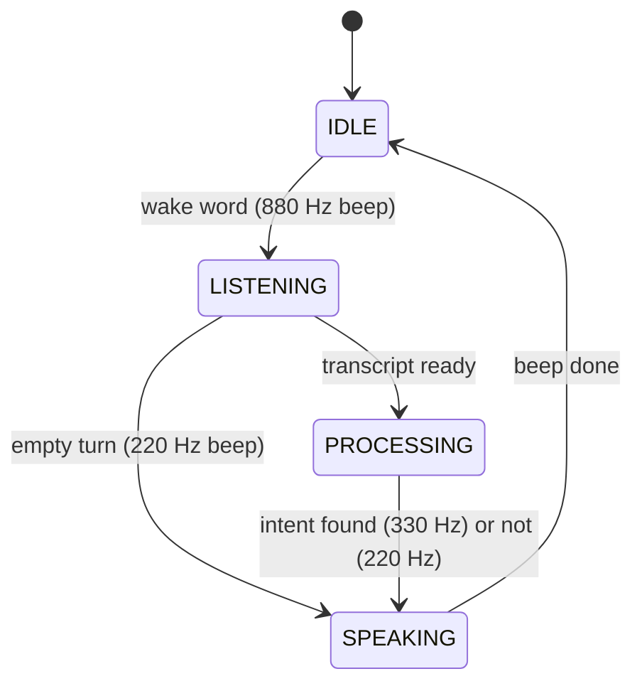
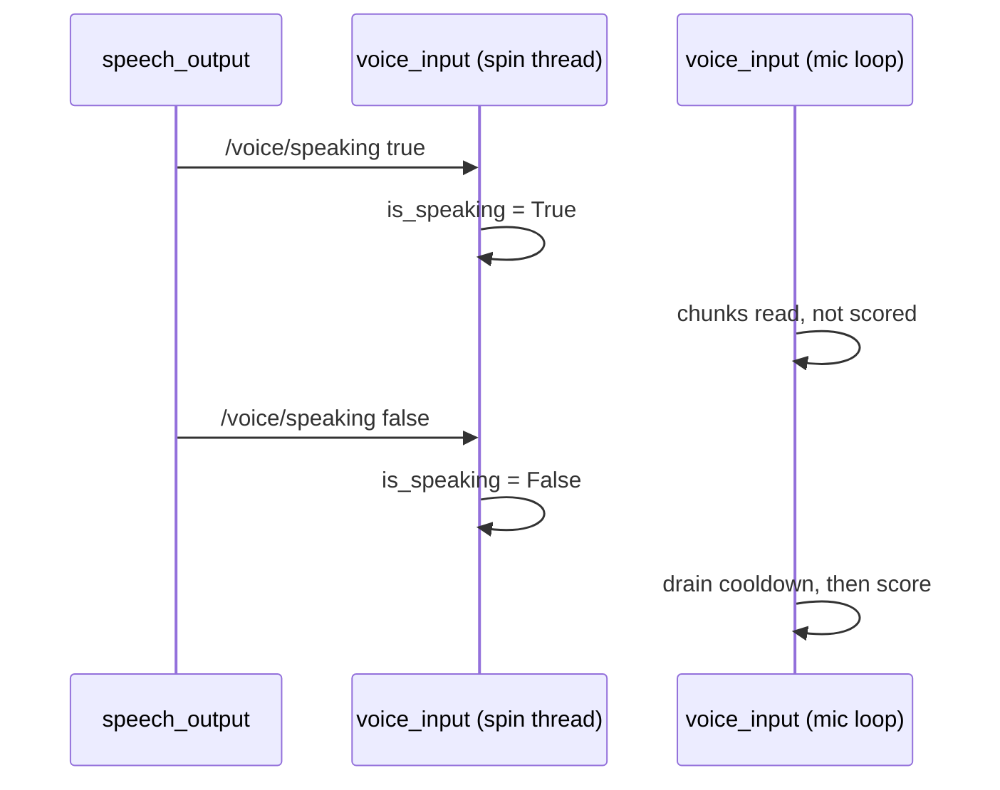

# 03 — `voice_input_node.py`: The ROS Shell

## Introduction

This is where the ROS-free pipeline meets the robot. `voice_input_node.py` does four things:

- runs `VoiceRuntime` in a loop, one turn at a time
- maps each transcript to an intent
- publishes the intent on `/intent` and the node's state on `/voice/state`
- plays a beep at each step, so the person gets feedback without a screen
- **stops listening for the wake word while the robot speaks**, using `/voice/speaking` from `speech_output`

It is deliberately thin: about 150 lines, with all the audio logic left in `runtime.py`.

## Two topics, both plain strings

```python
self.intent_pub = self.create_publisher(String, "/intent", 10)
self.state_pub = self.create_publisher(String, "/voice/state", 10)
```

- **`/intent`** carries the intent dict as **JSON inside a `std_msgs/String`**. That avoids a custom message type, so any node can read it. The cost is that the schema is a convention, not something ROS checks.
- **`/voice/state`** carries one of `IDLE`, `LISTENING`, `PROCESSING`, `SPEAKING`. Another node can, for example, pause motion while the robot is listening.

## The state cycle



**"SPEAKING" really means "giving feedback".** The node only plays a beep here. Real speech comes from `speech_output_node`; this node learns about it only through `/voice/speaking` (next section).

## A blocking loop, with callbacks on a side thread

Most ROS nodes call `rclpy.spin` and react to callbacks. This one **owns the main thread** with a blocking mic loop, because `next_turn` reads audio continuously. But it also has one subscription, so callbacks need somewhere to run.

### Spinning in the background

```python
def spin_in_background(node: Node) -> SingleThreadedExecutor:
    executor = SingleThreadedExecutor()
    executor.add_node(node)
    ...
    threading.Thread(target=spin, daemon=True).start()
    return executor
```

- **A daemon thread** spins the executor, so a stuck callback can never keep the process alive after `main` returns.
- **`ExternalShutdownException` ends the spin quietly**: that is what rclpy raises on Ctrl-C or the launcher's SIGTERM.
- `finally` calls `executor.shutdown()` before destroying the node, so shutdown is deterministic.

### Half-duplex: muting on `/voice/speaking`

```python
self.is_speaking = False
self.create_subscription(Bool, "/voice/speaking", self.on_speaking, 10)
```

The callback just stores the latest value. The main loop hands the runtime a *callable*, not the flag, so it reads the current value on every chunk:

```python
turn = runtime.next_turn(
    ok_fn=rclpy.ok,
    on_wake=on_wake,
    is_muted_fn=lambda: node.is_speaking,
)
```

Reading a plain `bool` written by another thread is safe in CPython: assignment of a single attribute is atomic under the GIL. The worst case is reading a value one 80 ms chunk late.

This solves two problems at once:

- **The robot doesn't hear itself.** Without echo cancellation, a reply containing the wake word would start a turn.
- **Beeps don't fight speech.** A wake during speech used to play a beep while `speech_output` held the sound card; `aplay` failed with "Device or resource busy" and the listener crashed.



### The rest of the loop

```python
while rclpy.ok():
    def on_wake(_wake):
        ...
    turn = runtime.next_turn(...)
    if turn.metadata and not turn.metadata.get("wake", {}).get("wake_hit", False):
        break
    node.process_turn(turn, device_index=device_index)
    node.publish_state("IDLE")
```

- **`on_wake` is a callback into the runtime.** The runtime knows nothing about ROS or beeps; it just calls back at the moment of the wake, which is exactly when the beep has to play.
- **`ok_fn=rclpy.ok` makes the stop prompt.** On SIGTERM, `rclpy.ok()` turns false, the runtime notices within one 80 ms chunk, and `next_turn` returns without a wake.
- **A turn without a wake ends the node.** That's right for shutdown. But it also means that if `arecord` dies, the stream ends, and the node exits quietly with no error logged.

## Turning a turn into feedback

`process_turn` splits on whether anything was heard:

- **Empty turn.** Log the noise floor, the cutoff, and whether speech ever started. That is the information needed to tune silence detection. Then play the failure beep.
- **Text.** Hand it to `process_transcript`, which maps it, publishes the intent if there is one, and plays the matching beep.

The empty-turn log line is the most useful diagnostic the node has. When a command "isn't heard", the floor and cutoff show whether it was too quiet or never started.

## Configuration

```python
voice_config = load_voice_runtime_config()
device_index = int(os.environ.get("VOICE_DEVICE_INDEX", voice_config.capture_card))
```

- The config comes from the node's `config` parameter, which `robot.launch.py` sets to the installed `voice.yaml` (chapter 05). An empty parameter stops the node at startup. The same object is shared with `VoiceRuntime`, and the node reads its beep settings from it.
- `device_index` is passed to every `beep()`. **But `beep()` ignores it**: it plays on `$SPEECH_ALSA_DEVICE` instead (chapter X01).

## Observations

1. **`device_index` and `VOICE_DEVICE_INDEX` do nothing.** They are carried through four calls and then dropped by `beep()`. Removing them, or making `beep()` use them, would remove a misleading knob.
2. **The beep call is written out four times** with the same three attributes. A small `beep_for(kind)` helper would take that from 4 × 4 lines to 4 × 1.
3. **A dead microphone exits the node silently.** Logging *why* the loop ended (shutdown vs stream ended vs timeout) would make a failed arecord visible.
4. **Three tests in I01 fail on `voice_config`.** They build the node with `__new__`, skipping `__init__`, so the attribute added later is never set. The tests need updating, not the node.
5. **`on_wake` is redefined on every turn.** It is harmless, but defining it once before the loop would read more clearly.
