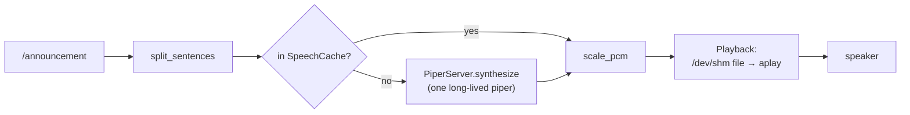
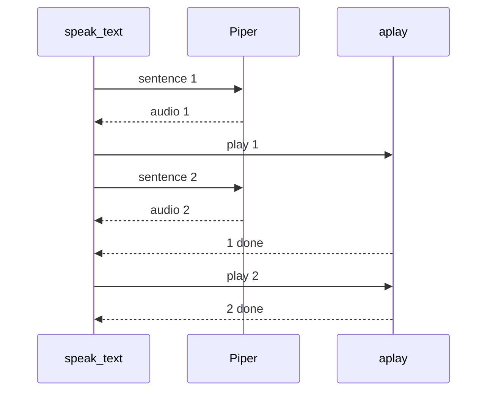

# 04 — `speech_output_node.py`: Giving the Robot a Voice

## Introduction

`speech_output_node` subscribes to `/announcement` and speaks each message aloud. It is the only node in the stack that produces speech. Anything that wants the robot to talk publishes an announcement and leaves the rest to this node.

Since F15 (2026-11-22) it is built for **a short gap between announcement and sound**. The synthesis itself lives in `dome_voice.piper_server` (chapter 07); this node decides *what* to synthesise *when*, and plays it:



Around each announcement it also publishes **`/voice/speaking`** (`std_msgs/Bool`), so listeners can stop listening while the robot talks.

## Why F15 changed it

Before F15, every announcement started a fresh `piper --output_raw` and streamed its output through numpy into `aplay`. TF15.0 measured that on the robot:

| Part | Time |
|---|---|
| dome_pad press → `/announcement` | 8–12 ms |
| Piper loading the voice model | **≈ 0.6 s, every time** |
| Synthesising "linear speed 0.2, angular speed 0.7" | ≈ 0.9 s |
| `aplay` opening the card (cold / warm) | 0.09 / 0.04 s |

So **most of the wait was Piper starting up**. The fixes follow directly:

- **Keep one Piper running** and feed it requests (chapter 07). The 0.6 s goes away after startup.
- **Cache sentences** already spoken. A repeated status reply needs no synthesis.
- **Speak a sentence at a time**, so a multi-sentence reply starts after its first sentence, as the old streaming path did.

## The announcement contract

The message type and the `Announcement` dataclass both come from `dome_control.announcement_contract`. An announcement has `text`, `priority`, `stamp`, `source` and `dedup_key`.

This node uses only `text`, plus `priority` and `source` for the log line. **Priorities and dedup keys are carried but not acted on yet.** There is no queue, no pre-emption and no dropping of repeats.

## Configuration: the YAML for tuning, the environment for paths

| Setting | Source | Robot value |
|---|---|---|
| `gain` | `speech:` in `voice.yaml` | 0.5 |
| `length_scale` | `speech:` in `voice.yaml` | 1.0 |
| `alsa_device` | `speech:` in `voice.yaml` | `plughw:0,0` |
| `DOME_PIPER_BIN` | environment | set by `provision_dome` |
| `DOME_PIPER_MODEL_PATH` | environment (required) | set by `provision_dome` |

**Tuning goes in the YAML; install paths stay in the environment.** The YAML arrives as the **`config` parameter**, set by `robot.launch.py`, and `load_speech_settings` (chapter 01) validates it strictly, so a gain of 0 stops the node at startup.

Startup also reads the **voice's sample rate** from the `<model>.onnx.json` Piper ships beside every voice. **Raw PCM has no header**, so `aplay -t raw` must be told the rate, and the WAVs Piper writes are checked against it (chapter 07).

Startup then **starts the long-lived Piper**:

```python
self.piper = PiperServer(
    piper_command(self.piper_bin, self.piper_model_path, self.length_scale),
    self.sample_rate,
    SPEECH_DIR,
)
self.cache = SpeechCache()
```

The model loads while the rest of the stack is still coming up, so the first announcement doesn't pay for it.

## Speaking one message

### A sentence at a time, pipelined

`speak_text` walks the text's sentences and **overlaps work with playback**: while sentence *n* plays, sentence *n + 1* is synthesised.

```python
for index, sentence in enumerate(split_sentences(text)):
    pcm = scale_pcm(self.sentence_audio(sentence), self.speech_gain)
    if playing is not None:
        playing.wait()
    playing = Playback(pcm, play_cmd, self.play_path(index))
playing.wait()
```

The order inside the loop is the point:

1. **Synthesise first.** This happens while the previous sentence is still playing.
2. **Then wait** for that sentence to finish.
3. **Then start** the new one.

This is a two-stage *software pipeline*. Synthesis runs about 5× faster than speech on the robot, so sentence *n + 1* is normally ready before sentence *n* ends, and the listener hears no gap beyond Piper's own sentence pause and an `aplay` start (about 40 ms).



**Why split at all**, when Piper already splits internally? Because a WAV only appears when its whole text is done. Sending the whole reply would make a two-sentence joke wait for both sentences, which is slower than the old streaming path. Splitting ourselves gets back the early start.

### The cache

```python
def sentence_audio(self, sentence: str) -> bytes:
    pcm = self.cache.get(sentence)
    if pcm is None:
        pcm = self.piper.synthesize(sentence)
        self.cache.put(sentence, pcm)
    return pcm
```

The cache holds **unscaled** audio per sentence, and the gain is applied on the way out, so the cache never depends on the volume. Its key is the text alone: the voice and length scale can't change while the node runs. A changed sentence is simply a miss, never stale audio.

### Playback without blocking

```python
class Playback:
    def __init__(self, pcm, play_cmd, path):
        self.path = path
        path.write_bytes(pcm)
        self.proc = subprocess.Popen([*play_cmd, str(path)], stderr=subprocess.PIPE)
```

**`aplay` plays a file, not a pipe.** Writing a 4 s sentence into `aplay`'s stdin would block once the 64 KB pipe buffer filled, which is most of the sentence, and the pipeline would stall. A file in `/dev/shm` (RAM) is written in microseconds, `aplay` reads it at its own pace, and `speak_text` is free to synthesise the next sentence.

- **`wait`** reaps the player, deletes the file, and raises with `aplay`'s stderr if it failed.
- **`stop`** kills it and deletes the file. `speak_text`'s `finally` uses it, so an error mid-reply never leaves a player or a file behind.

### Gain with numpy

```python
def scale_pcm(pcm: bytes, gain: float) -> bytes:
    samples = np.frombuffer(pcm, dtype="<i2").astype(np.float32) * gain
    return np.clip(samples, -32768, 32767).astype("<i2").tobytes()
```

Multiplying samples is a linear volume change (0.5 ≈ −6 dB). **Clipping** protects against gain above 1: without it a loud sample would wrap from +32767 to −32768, which sounds like a crack.

## Failure handling, and the speaking flag

```python
self.speaking_pub.publish(Bool(data=True))
try:
    self.speak_text(announcement.text)
    ...
except (RuntimeError, ValueError, OSError) as exc:
    self.get_logger().error(f"Speech output failed: {exc}")
finally:
    self.speaking_pub.publish(Bool(data=False))
```

**`/voice/speaking` brackets the whole reply**, every sentence of it, and `False` comes out of a `finally`, so a failure can never leave listeners muted. Listeners ignore their wake word while it's true: *half-duplex*, the cheap answer to a mic without echo cancellation.

**One failed announcement must not kill the node.** The catch names what `speak_text` can raise: `RuntimeError` (Piper exited, `aplay` failed, a wrong-format WAV), `OSError` (a missing binary or file), `ValueError` (bad audio data).

## Shutdown

`destroy_node` closes the Piper server before the node goes, and `main()` treats `KeyboardInterrupt` and `ExternalShutdownException` as a normal stop, so stopping a launch prints no traceback and leaves no Piper running.

## Observations

1. **A dead Piper stays dead.** If the Piper process exits, every later announcement fails with "piper exited" until the node restarts. Restarting it once, on the next announcement, would make speech self-healing, but nothing has shown it's needed yet.
2. **Speech still blocks the callback.** With the default single-threaded executor, announcements arriving during speech queue in the 10-deep subscription buffer. Priorities (dome_control F08–F10) will need this to change.
3. **Piper takes every core while synthesising.** On 2026-11-22 the EKF missed its 30 Hz deadline around speech. Running Piper under `nice` would let the EKF win, at some cost in synthesis time.
4. **Sentence splitting is simple.** It breaks at `.`/`!`/`?` plus whitespace, so "e.g. this" splits early. Harmless for robot speech, but a smarter splitter could keep abbreviations whole.
5. **The flag uses default QoS.** A listener starting mid-reply misses the `True`; a *transient local* publisher would give late joiners the current state.
