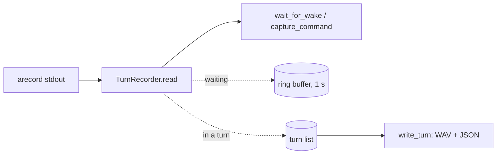

# 06 — `turn_recorder.py`: Hearing What the Robot Heard

## Introduction

Before this module, every tuning decision was a guess checked by talking to the robot again. **`TurnRecorder` saves each voice turn as a WAV file**, so a failure can be listened to, measured, and replayed offline through the same code.

It earned its keep on its first day. Recordings showed that the wake beep started the command turn, and that speech reached Vosk too quietly. Replaying them through `capture_command` reproduced the live results exactly, so fixes could be measured before anyone spoke to the robot again (I02).

## The design: a stream wrapper

The runtime reads the mic through one method, `stream.read(size)`. `TurnRecorder` *is* a stream: it forwards `read` to the real one and keeps a copy of what passed through.



- **Nothing else changes.** `wait_for_wake` and `capture_command` don't know they're being recorded. That's the *decorator* pattern applied to a file-like object.
- **No work when off.** `VoiceRuntime` only wraps the stream when `record_dir` is set.

## Two modes

```python
def read(self, size: int) -> bytes:
    data = self.stream.read(size)
    if self.turn_reads is None:
        self.preroll.append(data)
    else:
        self.turn_reads.append(data)
    return data
```

**Waiting.** Reads go into `preroll`, a `collections.deque` with `maxlen` set to 1 s of reads. Appending to a full deque drops its oldest item in O(1), so this is a *ring buffer* for free. Between turns, memory stays fixed at about 64 KB however long the robot waits.

**In a turn.** `mark_wake` turns the ring buffer into the start of a list, and every later read is appended. `self.turn_reads is None` *is* the mode flag, so there is no separate boolean to keep in sync.

## Why record from before the wake

```python
def mark_wake(self) -> None:
    self.turn_reads = list(self.preroll)
    self.preroll_bytes = sum(len(data) for data in self.turn_reads)
    self.preroll.clear()
```

openWakeWord fires after it has heard most of "marvin". Recording only from that moment would hide **what the wake word did to the command**, which is exactly the question one-breath commands (F10) raise.

`preroll_bytes` becomes `wake_offset_secs` in the sidecar, so a reader or a replay tool knows where in the file the wake happened.

## Writing a turn

```python
samples = stereo_to_mono(b"".join(self.turn_reads))
```

- **The WAV is unfiltered mono.** It is the same stereo average `read_mono_chunk` makes, but taken *before* the bandpass. A replay feeds it back through the live filter, so recorded and live audio go through identical processing.
- **`stereo_to_mono` lives here and is used by `runtime.py`**, so the two can't drift apart.
- **The JSON sidecar** holds what the pipeline heard (`heard_summary` in chapter 01), the intent it maps to, `wake_offset_secs`, and `expected: null`. The person labelling the recordings fills in `expected` by hand, for F05's replay tool to score against.
- **Timestamps to the microsecond** name the files, so two turns never collide.

`write_turn` without `mark_wake` raises: it would mean the runtime's turn sequence broke, and writing an empty or partial file would hide that.

## Observations

1. **A recording ends where the live turn ended.** A setting that would keep listening longer, such as a larger `silence_secs`, can't be judged from it. Recording about 2 s past the end would fix that (TF05.3).
2. **`RATE` is defined here and imported by `runtime.py`**, because the import has to go this way round. An `audio_format.py` holding the format constants would be a more natural home.
3. **Recordings are personal audio.** They belong outside the repo; `record_dir` defaults to off, and the robot's YAML keeps it `none` in git.
